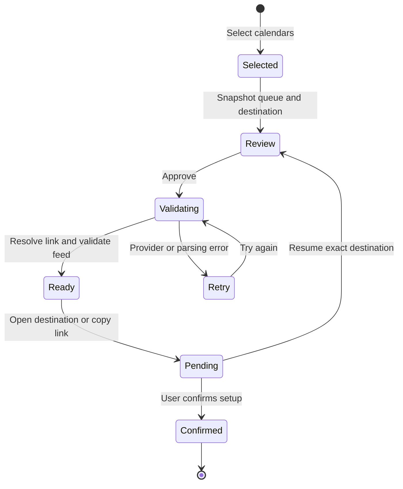

# Architecture

Team Calendar helps users discover public feeds and complete a subscription in their chosen calendar service. It does not maintain a second calendar database or require access to a user's existing events.

## Modules

| Layer | Responsibility | Boundary |
| --- | --- | --- |
| `CalendarCore` models | Catalog metadata, subscription identity, destination routing, preview events | Foundation value types; no SwiftUI or AppKit |
| `FeedClient` | HTTPS fetches, preview cache, college link resolution, rate-limit cooldown | Actor; injectable URLSession and clock for offline tests |
| `ICalendarParser` / `RecurrenceExpander` | Read public iCalendar text and produce a bounded preview | Pure input/output with explicit partial-preview information |
| `LibraryFile` | Load and atomically save a versioned snapshot | Caller supplies the file URL; tests use temporary directories |
| `AppStore` | Catalog navigation, favorites, selection, immutable review queue, subscription records | Main-actor observable state; injectable catalog and library path |
| SwiftUI views | Discovery, details, review, handoff steps, and Settings | Bind to app state; transient view state stays in the owning view |
| `CalendarHandoff` | Open Apple Calendar or a browser and copy feed URLs | The only subscription-related AppKit adapter |

The package has no external Swift dependencies. Views share small native components and a single provider directory for Settings and Help. The bundled JSON is the catalog's source of truth; scripts propose updates for review.

## Approval and handoff

`AppStore.beginReview` captures the selection and refuses to replace it while another sheet is open. The sheet owns its destination value, seeded from the saved preference or the resumed record. Approval saves the preference. Async validation is tied to the approved feed, step index, and retry token, so a stale result cannot enable a different feed's handoff.

Opening a destination or copying a validated link creates a pending record. Only **I've Added This Calendar** marks it confirmed. Records retain the complete target, including an Exchange web address. Resume uses that exact target. The app cannot observe completion or later removal in external services; forgetting a record only changes the local library.

Favorites express long-term interest; selection is a temporary review queue. Selecting or deselecting visible results respects the current category, league, and search, preserving hidden selections. The subscription list prioritizes pending status if a calendar has unfinished setup in any destination.

## Identity and persistence

Catalog IDs identify browsing state. Validated feed URLs identify resolved subscriptions, preventing a changed URL from inheriting an old confirmation. History groups all URL versions of a catalog entry and labels older feeds, so their pending setup remains accessible. A college feed's stable ID and public team key bridge its unresolved and resolved forms. Destination settings are normalized so irrelevant fields do not create duplicate records.

The library is stored at `~/Library/Application Support/TeamCalendar/library.json`. It contains custom feeds, selected and favorite IDs, subscription records, the default target, and resolved public college URLs. Writes are atomic. Optional additions remain compatible with version-one libraries. Unreadable or unknown-version files are preserved, and saving is disabled with a visible error until the file is repaired or moved.

Subscription records retain source metadata. A removed custom source can still be selected from its history, and re-adding its URL restores the existing identity. Unknown saved selection and favorite IDs are pruned when loading.

## Networking and preview limits

Requests use an ephemeral, cookieless URLSession with request/resource timeouts. Feed bodies are limited to 5 MB; college resolution responses to 32 KB. URLs must use public DNS hostnames over HTTPS, without embedded credentials; redirect checks apply the same policy. This is URL validation, not a DNS-rebinding defense. Custom sources should be trusted public feeds.

College resolution coalesces simultaneous requests per team key and caches successful URLs in memory and the library. Provider 429 responses honor Retry-After seconds or HTTP dates. A missing or invalid value uses a 15-minute cooldown. The app never sends calendar account credentials to feed providers.

Previews cache for ten minutes; explicit refresh and approval validation bypass that cache. The parser supports all-day and timed events, UTC/IANA/Twitch time zones, folded text, cancellations, valid durations, and daily/weekly recurrence with exclusions and moved occurrences. Nominal day/week durations preserve wall-clock boundaries across daylight saving changes.

Preview expansion covers 180 days and shares a 20,000 candidate-day budget across the feed. Unsupported recurrence rules, RANGE exceptions, time zones, invalid durations, or exhausted expansion budgets produce a partial-preview notice. Durations over 20,000 days are skipped. The destination receives the original URL and interprets the complete feed itself.

## Verification

`CalendarCoreTests` cover catalog expectations, routing, URL policy, parsing, recurrence, and stubbed provider behavior. `TeamCalendarTests` cover review stability, explicit confirmation, persistence compatibility, custom-source history, favorites, scoped selection, and destination-specific resume behavior. Tests never open calendar apps or use personal accounts.

CI runs these tests and builds/signature-checks the release bundle on Apple Silicon and Intel. The separate live feed checker is a maintenance tool, not a CI dependency. Native UI checks and final subscriptions to personal services remain manual; see [validation notes](VALIDATION.md).
